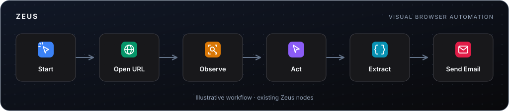
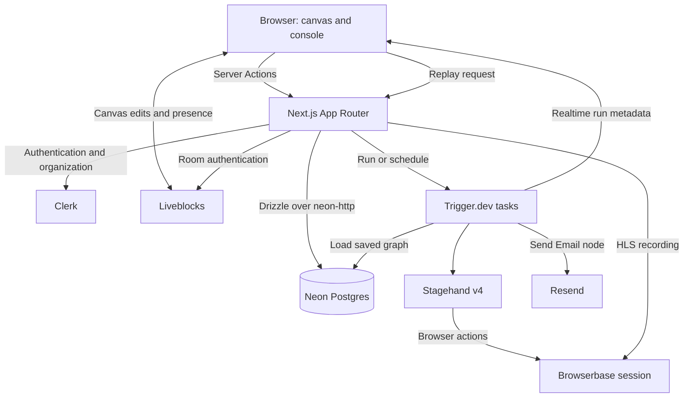

<div align="center">



# Zeus

**Automate the browser. Not the code.**

Zeus is a visual workflow platform for browser automation. Build workflows together, run browser actions, extract data, and send results by email.

[![CI][ci-shield]][ci-url] [![Next.js 16][next-shield]][next-url] [![React 19][react-shield]][react-url] [![TypeScript 5][ts-shield]][ts-url] [![Tailwind CSS 4][tailwind-shield]][tailwind-url] [![Clerk][clerk-shield]][clerk-url] [![Trigger.dev][trigger-shield]][trigger-url] [![Neon][neon-shield]][neon-url]

[Live demo](https://zeus-eight-xi.vercel.app) · [Workflow nodes](#workflow-nodes) · [Architecture](#architecture) · [Getting started](#getting-started) · [Project structure](#project-structure) · [CI/CD](#cicd)

</div>

> [!NOTE]
> Zeus combines a collaborative workflow canvas with browser automation, scheduled background runs, live step logs, and browser session replay.

## Overview

Zeus lets teams connect browser actions on a shared canvas and configure them with natural-language instructions. Earlier node outputs can be used in later steps, including emails. Workflows can run manually or on a schedule, with progress shown on the canvas and in the run console.

The app uses Next.js 16, React 19, and Tailwind CSS, with Clerk for organizations and billing, Liveblocks for collaboration, Neon Postgres for storage, Trigger.dev for execution, and Stagehand v4 on Browserbase for browser automation.

## Features

- Visual workflow canvas with movable, connected nodes and a field editor
- Real-time collaborative editing, teammate cursors, and presence avatars
- Natural-language browser actions, observation, and JSON data extraction
- Upstream output references in downstream fields, including nested values
- Durable background runs with live step statuses, outputs, errors, and durations
- Run history, a Run/Stop toggle, and stopped/skipped status display
- Browser session replay for successful runs with a recorded session
- Scheduling presets with timezone selection and a `/scheduled` page
- Plain-text email delivery through Resend
- Clerk organization switching, billing, and Pro-plan checks
- Light and dark themes

## Workflow nodes

| Node       | Kind    | Purpose                                                         |
| ---------- | ------- | --------------------------------------------------------------- |
| Start      | Trigger | Workflow entry point on the canvas                              |
| Open URL   | Action  | Navigate to a URL and return its URL and title                  |
| Observe    | Action  | Find candidate browser actions from an instruction              |
| Act        | Action  | Perform a specific browser action from an instruction           |
| Agent      | Action  | Observe once, then execute the returned actions in sequence     |
| Extract    | Action  | Extract JSON data from the current page                         |
| Send Email | Action  | Send a plain-text email using configured or interpolated values |

The Agent node uses Stagehand's `observe` and `act` methods; it is not an open-ended autonomous agent. Adding it from the toolbar requires an organization Pro plan. Creating any workflow also requires the `org:pro` plan checked by the server action.

Downstream fields accept `{{nodeId}}` for a whole output and `{{nodeId.path}}` for a nested value. The editor's **Connections** buttons insert references to upstream outputs. Interpolation is implemented in [`features/workflows/lib/interpolate.ts`](features/workflows/lib/interpolate.ts).

> [!IMPORTANT]
> The email executor currently sends from `onboarding@resend.dev`, so delivery is subject to Resend's test-sender restrictions. The replay viewer gets its session ID from successful task output; failed or cancelled runs do not currently return that ID to the viewer.

## Tech stack

| Layer              | Choice                                                         |
| ------------------ | -------------------------------------------------------------- |
| Framework          | Next.js 16 (App Router)                                        |
| UI                 | React 19, Tailwind CSS 4, shadcn/ui, Base UI, Radix UI, Lucide |
| Canvas             | React Flow (`@xyflow/react`)                                   |
| Collaboration      | Liveblocks                                                     |
| Auth and billing   | Clerk organizations and Pro-plan checks                        |
| Database           | Neon Postgres                                                  |
| ORM and migrations | Drizzle ORM, Drizzle Kit                                       |
| Validation         | Zod 4                                                          |
| Browser automation | Browserbase, Stagehand v4                                      |
| Background runtime | Trigger.dev 4                                                  |
| Email              | Resend                                                         |
| Replay playback    | HLS.js                                                         |
| Monitoring         | Sentry                                                         |
| Tooling            | TypeScript, ESLint, Prettier                                   |

## Architecture

### Request path



### Workflow lifecycle

1. Create a workflow in the active Clerk organization and add nodes from the toolbar.
2. Connect nodes, edit their fields, and insert upstream output references where needed. Liveblocks synchronizes canvas edits between collaborators.
3. Click **Run** to save the current graph and trigger the `run-workflow` task.
4. The task loads the saved graph, topologically sorts connected nodes, and executes them sequentially. Cycles cause an error; unconnected nodes are not executed.
5. The first browser step opens a Browserbase session, reused by later browser steps. Step metadata updates the canvas and console as the run progresses.
6. Successful runs return step results and the browser session ID for replay. The task closes Stagehand and the browser in a `finally` block.
7. Choose a schedule preset and timezone for recurring runs. The `scheduled-workflow` task loads the saved workflow and triggers `run-workflow`.

## Getting started

### Prerequisites

- Node.js 20.9 or newer (CI uses Node.js 22)
- npm
- A Neon Postgres database
- A Clerk application with organizations and an organization Pro plan matching the `org:pro` check
- Liveblocks, Browserbase, Trigger.dev, and Resend accounts and API keys

### 1. Install dependencies

```bash
npm install
```

### 2. Configure environment variables

Create `.env.local` in the project root:

```dotenv
# Neon
DATABASE_URL="postgresql://..."
DATABASE_URL_UNPOOLED="postgresql://..."

# Clerk
NEXT_PUBLIC_CLERK_PUBLISHABLE_KEY="pk_test_..."
CLERK_SECRET_KEY="sk_test_..."

# Liveblocks
LIVEBLOCKS_SECRET_KEY="sk_..."

# Browserbase
BROWSERBASE_API_KEY="..."
# Optional: pre-uploaded Stagehand extension
BROWSERBASE_EXTENSION_ID=""

# Trigger.dev
TRIGGER_SECRET_KEY="tr_dev_..."

# Resend
RESEND_API_KEY="re_..."
```

[`.env.example`](.env.example) contains database, Liveblocks, Resend, extension, and Sentry placeholders, but does not include all the keys above. `DATABASE_URL_UNPOOLED` is required by Drizzle Kit. The application prefers it when set and otherwise falls back to `DATABASE_URL`.

Set `project` in [`trigger.config.ts`](trigger.config.ts) to your Trigger.dev project ID. Supply the same database and provider credentials to the task runtime. The current browser model is `google/gemini-2.5-flash`, routed through Browserbase's Model Gateway; no separate model-provider key is configured.

### 3. Apply the database schema

```bash
npm run db:migrate
```

### 4. Start the app and workflow runtime

Run these in separate terminals:

```bash
npm run dev
npx trigger.dev@latest dev
```

### 5. Create a workflow

Open `http://localhost:3000`, sign in, and create or select an organization with the required Pro plan. Create a workflow, connect **Start** to **Open URL**, and set the URL in the editor. Click **Run** to see step progress in the console.

Run once before scheduling to save the current graph: schedules execute the saved graph, not unsaved canvas edits.

## Project structure

```text
app/
  (auth)/                    Sign-in and sign-up
  (dashboard)/               Workflows, scheduled runs, billing
  api/liveblocks/            Collaboration authentication and users
  api/replays/[sessionId]/   Server-side replay proxy
  organization/             Organization creation
components/                 Shared UI, app shell, theme provider
features/workflows/
  actions.ts                Workflow CRUD, run, cancel, schedule actions
  data.ts                   Database queries
  components/               Canvas, editor, console, logs, replay viewer
  hooks/                    Organization plan and upstream connections
  lib/                      Validation, interpolation, schedule presets
  nodes/                    Node registry and executors
lib/
  db/                       Drizzle client and schema
  liveblocks.ts             Liveblocks server client
  resend.ts                 Resend client
  sentry.ts                 Error reporting
src/trigger/
  run-workflow.ts           Workflow execution task
  scheduled-workflow.ts     Recurring workflow trigger
drizzle/                    Database migrations
assets/readme/              README SVG illustration
.github/workflows/ci.yml    CI checks
drizzle.config.ts
trigger.config.ts
```

## Scripts

| Command                      | Description                                           |
| ---------------------------- | ----------------------------------------------------- |
| `npm run dev`                | Start the Next.js development server                  |
| `npm run build`              | Create a production build                             |
| `npm run start`              | Serve the production build                            |
| `npm run lint`               | Run ESLint                                            |
| `npm run typecheck`          | Run `tsc --noEmit`                                    |
| `npm run format`             | Format TypeScript and TSX files with Prettier         |
| `npm run db:generate`        | Generate a Drizzle migration from schema changes      |
| `npm run db:migrate`         | Apply pending Drizzle migrations                      |
| `npm run db:push`            | Push the schema directly, bypassing migration history |
| `npm run db:studio`          | Open Drizzle Studio                                   |
| `npx trigger.dev@latest dev` | Run the workflow tasks locally                        |

## Adding a workflow node

Nodes are registry-driven. A standard action node requires three edits under [`features/workflows/nodes/`](features/workflows/nodes/):

1. Add the executor implementation, such as `open-url.ts`.
2. Register it in `node-executors.ts`; the `satisfies` contract checks that every action node has an executor.
3. Add a manifest in `node-registry.ts` with its kind, label, icon, accent, input fields, and downstream outputs.

The task runner and canvas consume the registry; they do not need separate edits for a standard node.

## CI/CD

The repository's [GitHub Actions workflow](.github/workflows/ci.yml) runs on pushes to `main` and on pull requests, using Node.js 22:

- `npm ci`
- `npm run lint`
- `npm run typecheck`
- `npx prettier --check "**/*.{ts,tsx}"`
- `npm run build`

The workflow validates the app; it does not include a deployment step.

## Security

- Keep `.env.local` and provider credentials out of version control. Secret keys belong on the server or in the task runtime, not in public environment variables.
- Workflow listings and graph saves are scoped to the active Clerk organization; Liveblocks authentication includes that organization's identity.
- The replay proxy checks the session's organization metadata before returning its recording and keeps the Browserbase API key server-side.
- Server operations and client replay/realtime errors are reported to Sentry.

<!-- Badges -->

[ci-shield]: https://github.com/78days/Zeus/actions/workflows/ci.yml/badge.svg
[ci-url]: https://github.com/78days/Zeus/actions/workflows/ci.yml
[next-shield]: https://img.shields.io/badge/Next.js-16-000000?style=flat-square&logo=nextdotjs&logoColor=white
[next-url]: https://nextjs.org
[react-shield]: https://img.shields.io/badge/React-19-087EA4?style=flat-square&logo=react&logoColor=white
[react-url]: https://react.dev
[ts-shield]: https://img.shields.io/badge/TypeScript-5-3178C6?style=flat-square&logo=typescript&logoColor=white
[ts-url]: https://www.typescriptlang.org
[tailwind-shield]: https://img.shields.io/badge/Tailwind_CSS-4-06B6D4?style=flat-square&logo=tailwindcss&logoColor=white
[tailwind-url]: https://tailwindcss.com
[clerk-shield]: https://img.shields.io/badge/Clerk-7-6C47FF?style=flat-square&logo=clerk&logoColor=white
[clerk-url]: https://clerk.com
[neon-shield]: https://img.shields.io/badge/Neon-Postgres-00E599?style=flat-square&logo=neon&logoColor=black
[neon-url]: https://neon.tech
[trigger-shield]: https://img.shields.io/badge/Trigger.dev-4-41FFCA?style=flat-square&logo=triggerdotdev&logoColor=black
[trigger-url]: https://trigger.dev
